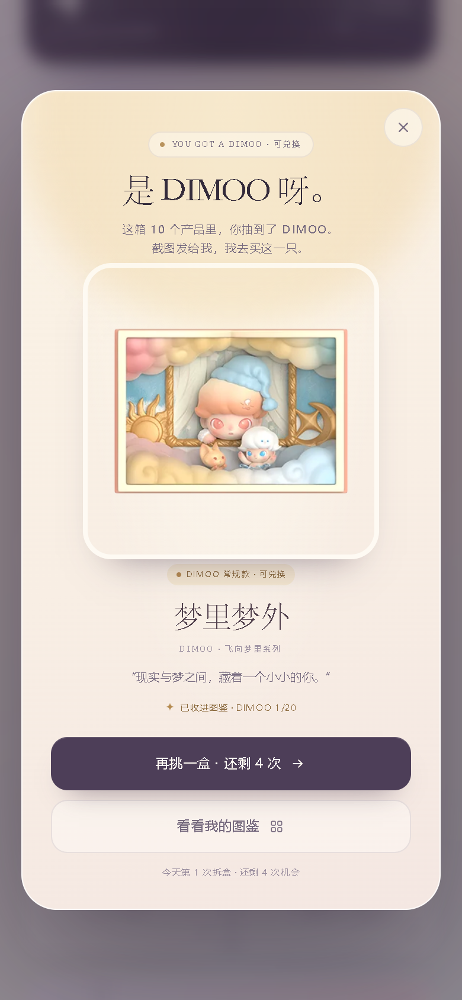

# 云朵抽盒社 · 只为你

一台只给一个人开机的泡泡玛特云朵抽盒机。参考泡泡玛特抽盒小程序的“挑盒 / 摇提示 / 拆盒 / 集图鉴”体验，做成了不需要服务器、打开就能玩的私人 H5。

**现在没有空盲盒。一箱 10 盒，全部是产品；每箱固定 2 个 DIMOO + 8 个其他 IP。两个 DIMOO 每次换箱都从 8 款 DIMOO 里随机抽，不是固定那四款。**


## 现在有什么

- **一箱 10 盒，全部有产品**：没有空盒、没有“再来一次”。
- **每箱固定 2 个 DIMOO + 8 个其他 IP 产品**：10 个产品互不重复，位置随机打乱。
- **DIMOO 每次随机生成**：从 8 款 DIMOO 款库中随机抽 2 款；对应系列和款式都会写在结果页、排除提示和本箱名册里。
- **其他 8 个产品固定**：来自 MOLLY / SKULLPANDA / CRYBABY，共 2 个 MOLLY + 2 个 SKULLPANDA + 4 个 CRYBABY，全部落实到具体系列和款式。
- **每天 5 次机会**：北京时间 00:00 补满；这一箱没拆完会留到明天，10 盒拆完后自动换新箱。
- **只有 DIMOO 才兑换**：抽中 DIMOO，截图给男朋友，他去买对应盲盒；抽中其他 IP 产品，按约定不兑换，只收进图鉴。
- **每个盒子 2 次排除提示**：提示会从**本箱 10 个产品**里排除一个，不会改变盒内结果，也不会透露位置。
- **提示跨天保留**：提示跟着盒子走；拆完这一箱、换新箱时才刷新。
- **图鉴与记录**：8 款 DIMOO + 8 款其他 IP，共 16 个图鉴位；DIMOO / 其他 IP 分开统计，并记录拆盒次数。
- **移动端优先**：支持添加到手机主屏幕，作为 PWA 离线打开。
- **没有付费、没有后台、没有真实交易**：记录只存在当前浏览器里。

## 这次改了什么

之前是“80% 空盒 + 6 个固定产品”。现在改成：

- 取消空盒；
- 取消空盒安慰券；
- 一箱 10 盒全部是产品；
- 每箱 2 个 DIMOO + 8 个其他 IP 产品；
- 2 个 DIMOO 每次换箱从 8 款 DIMOO 里随机抽；
- 其他 8 个产品固定，但每箱位置重新打乱。

## 完整产品池

### DIMOO：每箱随机抽 2 款（8 选 2）

| 系列 | 款式 |
| --- | --- |
| 瞬间的奇遇系列 | 打包春天 |
| 瞬间的奇遇系列 | 吹一口花香 |
| 瞬间的奇遇系列 | 飞过春天 |
| 瞬间的奇遇系列 | 头顶春天 |
| 动物王国系列 | 哄睡兔宝 |
| 动物王国系列 | 小鸭领队 |
| 在你身边系列 | 为你点灯 |
| 在你身边系列 | 送你糖果 |

这 8 款里，每次新箱随机抽 2 款，不会固定只出原来那四款。

### 其他 IP：每箱固定 8 个产品（MOLLY / SKULLPANDA / CRYBABY）

| IP | 系列 | 款式 | 约定 |
| --- | --- | --- | --- |
| MOLLY | 20 周年系列·沿途的风景 | 花花世界 | 不兑换 |
| MOLLY | 周年雕塑经典回归系列 | 月球小星星 | 不兑换 |
| SKULLPANDA | 温度系列 | 下雨天 | 不兑换 |
| SKULLPANDA | 温度系列 | 放轻松 | 不兑换 |
| CRYBABY | Crying Again 系列 | 哭哭兔 | 不兑换 |
| CRYBABY | Crying Again 系列 | 哭哭熊 | 不兑换 |
| CRYBABY | Crying For Love 系列 | 偷心大盗 | 不兑换 |
| CRYBABY | Crying For Love 系列 | 等爱的玫瑰红 | 不兑换 |

## 玩法与概率

- 开箱前随机挑一盒，抽中 DIMOO 的初始概率是 **2 / 10 = 20%**。
- 开盒后、使用排除提示后，剩余盒子的实际概率会变化；因为一箱里固定只有 2 个 DIMOO。
- 每个盒子 2 次提示；每次提示从本箱 10 个产品中排除 1 个，提示不会排除盒子自己的款式。
- 每天 5 次机会；一箱通常分两天拆完。每天 00:00 只补机会，不换箱；10 盒全部拆完后自动换新箱。

| 排除提示 | 拆到 DIMOO |
| --- | --- |
|  |  |

| 其他 IP（不兑换） | 云朵图鉴 |
| --- | --- |
|  |  |

本箱 10 个产品的名册可以在“概率说明”里查看：


## 怎么打开

### 1. 电脑上直接预览

双击 `index.html` 就能玩，抽盒、图鉴、音效都可正常使用。

> 直接双击打开时，浏览器会禁用 PWA 离线缓存，不影响抽盒本身。

### 2. 手机上使用（推荐）

页面是纯静态的，不需要后端。把整个 `cloudbox` 文件夹上传到任意静态托管即可：

- **Netlify Drop**：登录 [Netlify Drop](https://app.netlify.com/drop)，把整个 `cloudbox` 文件夹拖进去，得到一个 `https://...netlify.app` 链接。
- **Vercel / Cloudflare Pages / GitHub Pages**：同样把文件夹作为静态站点部署。
- 把生成的链接发到女朋友手机上打开。
- iPhone Safari：点“分享”→“添加到主屏幕”；Android Chrome：菜单→“安装应用 / 添加到主屏幕”。之后就像一个小 App 一样打开。

建议给站点设置一个不容易被猜到的名字，或只发她一个人。页面已经加了 `noindex` 和 `robots.txt`，不会被搜索引擎主动收录；但它不是密码保护，知道链接的人仍能打开，请不要公开发布。

### 3. 本地起一个 HTTP 服务

在 `cloudbox` 目录里：

```bash
python -m http.server 4173
```

然后访问 `http://127.0.0.1:4173`。

## 数据说明

- 存储键：`cloudbox.gift.v1`。
- 每日机会、整箱 10 个产品、已拆进度、每盒提示、图鉴和统计数据都在当前浏览器本地。
- 同一台设备换浏览器、清理网站数据，记录会重置。
- 不同设备之间不同步，各自有独立的每日 5 次。
- 日期和补给时间固定按**北京时间（Asia/Shanghai）**计算。
- 整箱 10 盒会跨天保留；每天只补机会，不换箱子。全部拆完才自动换新箱。

## 想自己改一点

### 产品池和随机逻辑

打开 `app.js`：

- `DIMOO_STYLES`：8 款 DIMOO 候选池，每箱随机抽 2 款。
- `OTHER_STYLES`：8 款其他 IP，每箱全部放入。
- `makeCaseItems()`：真正决定“一箱 10 个产品怎么来”的地方；当前是“随机 2 个 DIMOO + 全部 8 个其他 IP 产品”，再整体打乱位置。

```js
const CONFIG = Object.freeze({
  dailyChances: 5,
  boxCount: 10,
  timeZone: "Asia/Shanghai",
  ...
});
```

- `dailyChances: 5`：每天补满几次。
- `boxCount: 10`：一箱几盒；页面按 5 列自动换行。
- 没有 `emptyRate`，也没有空盒逻辑。

如果改“2 个 DIMOO / 8 个其他 IP”的比例，需要同步改 `makeCaseItems()`、`sanitiseState()` 里的数量校验、页面概率说明、名册和统计分母。

### 页面文字

- 标题、介绍、页脚：`index.html`
- “抽到什么都好，反正你已经有我了。”：`index.html` 搜索 `love-note`
- 颜色主题：`styles.css` 顶部的 `:root` 变量

### 次数和提示

- 当前是 **一箱 10 盒 / 每天 5 次**。箱子跨天保留，拆完 10 盒后自动换新箱。
- 每个盒子的 2 次提示写在 `updateHintPanel()` 和 `useHint()` 里，想改成 3 次要同时改这两处。
- 提示候选来自当前 `state.items`（本箱 10 个产品），不会排除盒子自己的款式。
- 提示跟着盒子走，跨天不会重置；换新箱时才会清空。

### 图标和分享封面

```bash
python scripts/generate_icons.py
```

会重新生成 `icons/` 里的 App 图标和 `og-cover.png`。需要安装 Pillow。

## 目录

```text
cloudbox/
├── index.html                 页面结构
├── styles.css                 全部样式与动画
├── app.js                     抽盒逻辑、提示、图鉴、音效
├── manifest.webmanifest       PWA 配置
├── sw.js                      离线缓存
├── robots.txt                 禁止搜索引擎收录
├── _headers                   静态托管隐私响应头
├── icons/                     App 图标 / favicon / 分享封面
├── preview/                   README 截图
├── scripts/
│   └── generate_icons.py      图标生成脚本
└── README.md
```

## 一点说明

这是一个个人制作的同人向小礼物，**不是泡泡玛特官方产品**。DIMOO、MOLLY、SKULLPANDA、CRYBABY 的产品名仅用于私人抽盒结果的索引；所有插画均为私人手绘同人版本，其他 IP 只绘制了包装盒，并非官方商品图。页面不售卖任何商品，也不涉及真实交易，请不要商用或公开传播。

抽中 DIMOO 才是真的中奖；其他 IP 产品按约定只收进图鉴。每一箱的 2 个 DIMOO 都是随机来的，下一次换箱可能就换成别的款了。
