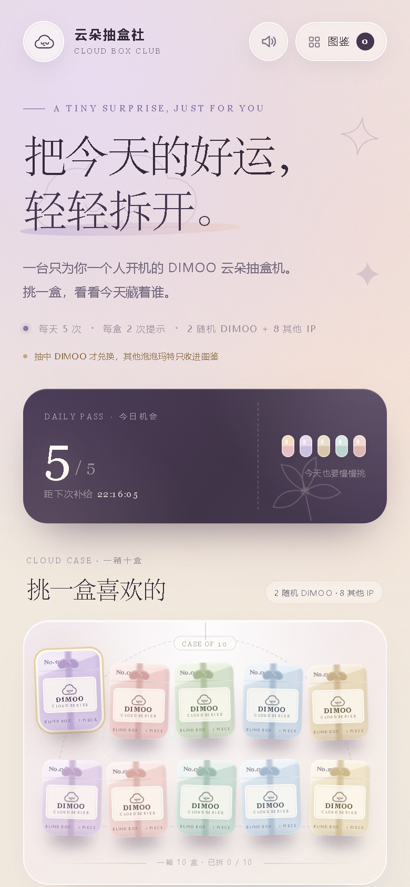
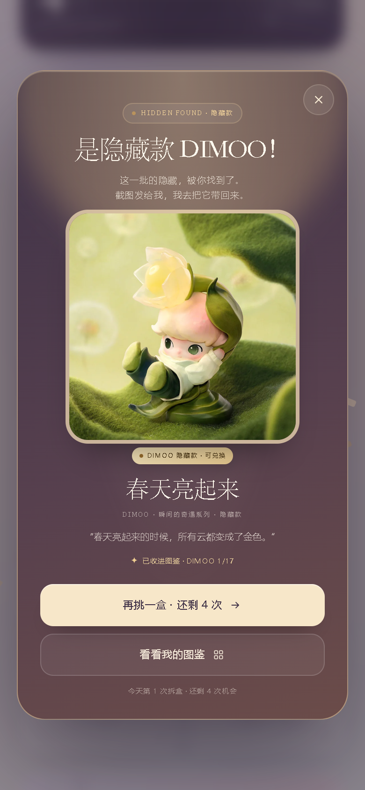
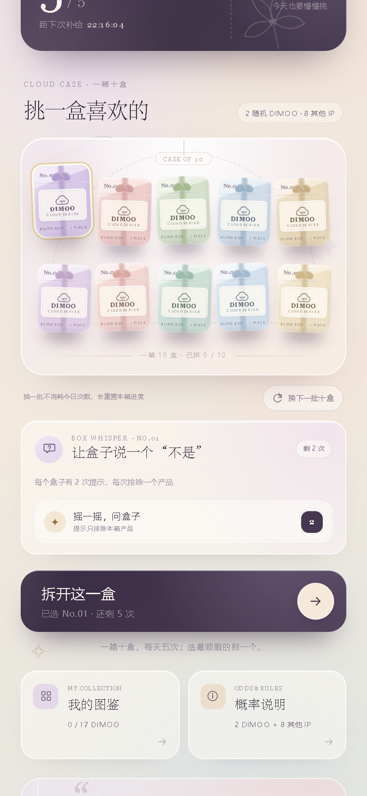
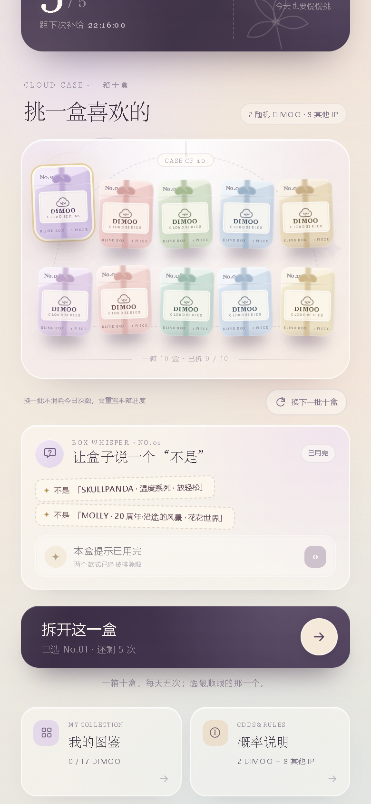
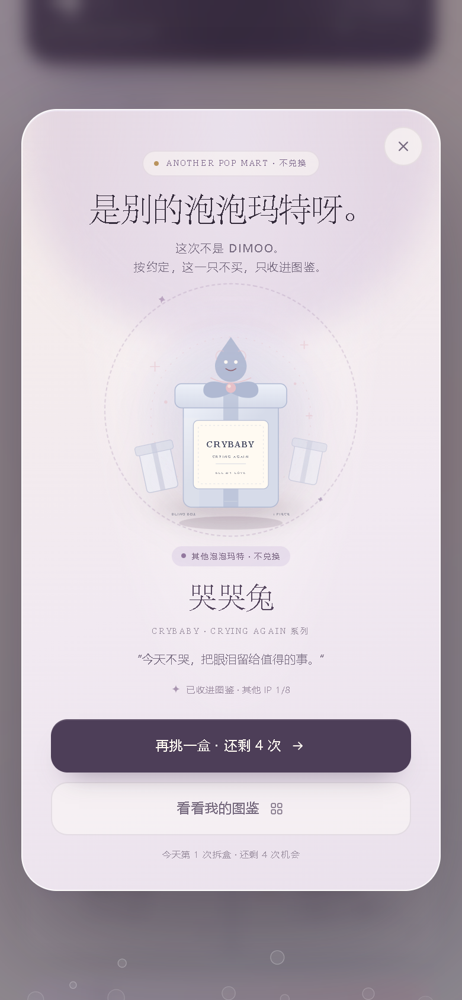
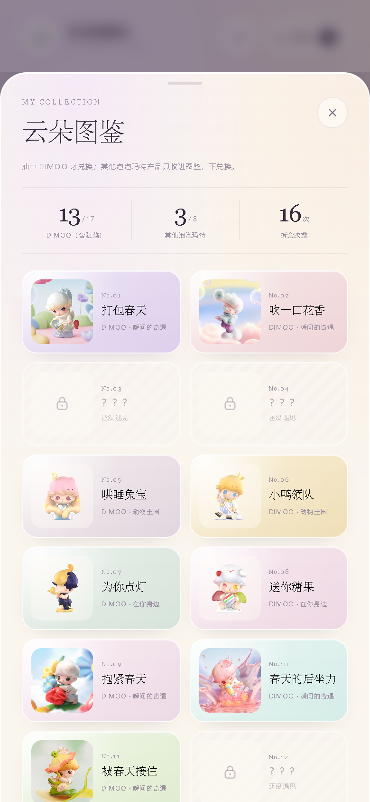
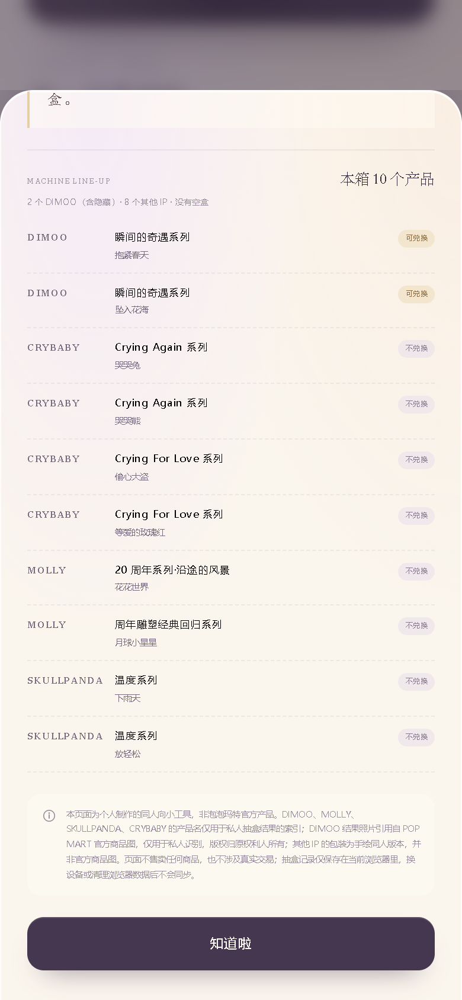

# 云朵抽盒社 · 只为你

一台只给一个人开机的泡泡玛特云朵抽盒机。参考泡泡玛特抽盒小程序的“挑盒 / 摇提示 / 拆盒 / 集图鉴”体验，做成了不需要服务器、打开就能玩的私人 H5。

**现在没有空盲盒。一箱 10 盒，全部是产品；每箱固定 2 个 DIMOO + 8 个其他 IP。2 个 DIMOO 从 16 款常规 + 1 款隐藏里随机，隐藏款每批约 5% 概率出现；盒子下面可以自由“换下一批十盒”。**



## 现在有什么

- **一箱 10 盒，全部有产品**：没有空盒、没有“再来一次”。
- **每箱固定 2 个 DIMOO + 8 个其他 IP 产品**：10 个产品互不重复，位置每批重新打乱。
- **隐藏款 DIMOO「春天亮起来」**：每批约 **5%** 概率把其中一个 DIMOO 换成隐藏款；剩下一个仍是常规 DIMOO。每批最多 1 个隐藏，隐藏也算 DIMOO，可兑换。
- **16 款常规 DIMOO 随机**：最新「瞬间的奇遇」全 12 款 + 4 款经典，从 16 款里不重复抽 2 款；不是固定只出原来那四款。
- **每个常规款都有对应商品照片**：结果页中间显示抽到的具体款式照片，不再用一张通用 DIMOO 插画代替。
- **自由换下一批**：盒子下方有“换下一批十盒”。不消耗今日次数；会重新随机 2 个 DIMOO、隐藏款和 10 个盒位，并重置本箱进度和提示。已经拆到的产品、图鉴、统计和今日次数都保留。
- **其他 8 个产品固定**：来自 MOLLY / SKULLPANDA / CRYBABY，共 2 个 MOLLY + 2 个 SKULLPANDA + 4 个 CRYBABY。每批变化的是 2 个 DIMOO、隐藏和 10 个盒位。
- **每天 5 次机会**：北京时间 00:00 补满；这一箱没拆完会留到明天，10 盒拆完后自动换新箱。
- **只有 DIMOO / 隐藏款才兑换**：抽中后截图给男朋友，他去买对应盲盒；抽中其他 IP 产品，按约定不兑换，只收进图鉴。
- **每个盒子 2 次排除提示**：提示会从**本箱 10 个产品**里排除一个，不会改变盒内结果，也不会透露位置。
- **提示跨天保留**：提示跟着盒子走；拆完这一箱或换下一批时才刷新。
- **图鉴与记录**：16 款常规 DIMOO + 1 款隐藏 + 8 款其他 IP，共 25 个图鉴位；DIMOO 统计为 /17，并记录拆盒次数。
- **移动端优先**：支持添加到手机主屏幕，作为 PWA 离线打开。
- **没有付费、没有后台、没有真实交易**：记录只存在当前浏览器里。

## 这一版新增

- 补齐最新「瞬间的奇遇」全 12 款常规，另有 1 款隐藏；
- 保留原来的 4 款经典，DIMOO 常规款扩到 16 款；
- 每个常规款都有对应的官方商品照片，结果页中间直接显示抽到的具体款式；
- 加入隐藏款 DIMOO「春天亮起来」，每批约 5%；
- 加入“换下一批十盒”按钮，可自由切换批次，不消耗次数；
- 换批会重新随机 2 个 DIMOO、隐藏款和 10 个盒位；
- 新批次的 2 个 DIMOO 组合会与上一批不同，不会连续刷出同一组；
- 图鉴扩到 25 格，DIMOO 统计改为 /17。

## 完整产品池

### DIMOO：每箱随机 2 个（常规 16 款 + 隐藏 1 款）

| 系列 | 款式 | 类型 |
| --- | --- | --- |
| 瞬间的奇遇系列 | 打包春天 | 常规 |
| 瞬间的奇遇系列 | 吹一口花香 | 常规 |
| 瞬间的奇遇系列 | 飞过春天 | 常规 |
| 瞬间的奇遇系列 | 头顶春天 | 常规 |
| 瞬间的奇遇系列 | 抱紧春天 | 常规 |
| 瞬间的奇遇系列 | 春天的后坐力 | 常规 |
| 瞬间的奇遇系列 | 被春天接住 | 常规 |
| 瞬间的奇遇系列 | 它住在靴子里 | 常规 |
| 瞬间的奇遇系列 | 捕捉春天 | 常规 |
| 瞬间的奇遇系列 | 带我去远方 | 常规 |
| 瞬间的奇遇系列 | 吹响春天 | 常规 |
| 瞬间的奇遇系列 | 坠入花海 | 常规 |
| 动物王国系列 | 哄睡兔宝 | 常规 |
| 动物王国系列 | 小鸭领队 | 常规 |
| 在你身边系列 | 为你点灯 | 常规 |
| 在你身边系列 | 送你糖果 | 常规 |
| 瞬间的奇遇系列 | **春天亮起来** | **隐藏款** |

- 每批先掷一次隐藏：约 5% 概率变成“1 个隐藏 + 1 个常规”，其余 95% 是“2 个常规”。
- 常规 DIMOO 从 16 款里不重复抽 2 款；隐藏款不会和另一只隐藏同时出现。
- 隐藏款出现时，本箱仍然是 2 个 DIMOO，不会变成 3 个。
- 每款常规 DIMOO 都有独立照片，结果页和已解锁图鉴显示对应商品图，不会用同一张通用图代替。

### 其他 IP：每箱固定 8 个产品（MOLLY / SKULLPANDA / CRYBABY）

| IP | 系列 | 款式 | 约定 |
| --- | --- | --- | --- |
| MOLLY | 20 周年系列·沿途的风景 | 花花世界 | 不兑换 |
| MOLLY | 周年雕塑经典回归系列 | 月球小星星 | 不兑换 |
| SKULLPANDA | 温度系列 | 下雨天 | 不兑换 |
| SKULLPANDA | 温度系列 | 放轻松 | 不兑换 |
| CRYBABY | Crying Again 系列 | 哭哭兔 | 不兑换 |
| CRYBABY | Crying Again 系列 | 哭哭熊 | 不兑换 |
| CRYBABY | Crying For Love 系列 | 偷心大盗 | 不兑换 |
| CRYBABY | Crying For Love 系列 | 等爱的玫瑰红 | 不兑换 |

## 玩法与概率

- 开箱前随机挑一盒，抽中 DIMOO 的初始概率是 **2 / 10 = 20%**；隐藏款也算 DIMOO。
- 隐藏款是**批次级**概率：每批约 5%。如果隐藏出现，它会替换掉 2 个 DIMOO 中的一个，所以每批仍然是 2 个 DIMOO。
- 相当于随机挑一盒时，隐藏款的初始概率约 **0.5%**；实际会随开盒和提示变化。
- 每个盒子 2 次提示；每次提示从本箱 10 个产品中排除 1 个，提示不会排除盒子自己的款式。
- 每天 5 次机会；一箱通常分两天拆完。每天 00:00 只补机会，不换箱；10 盒全部拆完后自动换新箱。
- “换下一批十盒”不消耗次数；换批只重置当前箱子的进度和提示，已经拆到的产品、图鉴、统计、今日次数都保留。

| 隐藏款 DIMOO | 换下一批 |
| --- | --- |
|  |  |

| 排除提示 | 拆到常规 DIMOO |
| --- | --- |
|  |  |

| 其他 IP（不兑换） | 云朵图鉴 |
| --- | --- |
|  |  |

本箱 10 个产品可以在“概率说明”里查看，隐藏款会单独标出来：



## 怎么打开

### 当前线上地址

已经部署在 GitHub Pages：

**https://al1c0ach.github.io/cloudbox-gift-7x3q/**

- iPhone：Safari 打开 → 分享 → 添加到主屏幕。
- Android：Chrome 打开 → 菜单 → 安装应用 / 添加到主屏幕。
- 建议从桌面图标进入，不要在微信内置浏览器里长期玩，否则记录会分开。

### 自己重新部署

页面是纯静态的，不需要后端。把整个 `cloudbox` 文件夹上传到任意静态托管即可：

- **Netlify Drop**：登录 [Netlify Drop](https://app.netlify.com/drop)，把整个 `cloudbox` 文件夹拖进去。
- **Vercel / Cloudflare Pages / GitHub Pages**：同样把文件夹作为静态站点部署。
- 建议给站点设置一个不容易被猜到的名字，或只发她一个人。页面已经加了 `noindex` 和 `robots.txt`，不会被搜索引擎主动收录；但它不是密码保护，知道链接的人仍能打开。

### 本地预览

在 `cloudbox` 目录里：

```bash
python -m http.server 4173
```

然后访问 `http://127.0.0.1:4173`。

## 数据说明

- 存储键：`cloudbox.gift.v1`。
- 每日机会、整箱 10 个产品、已拆进度、每盒提示、图鉴和统计数据都在当前浏览器本地。
- 同一台设备换浏览器、清理网站数据，记录会重置。
- 不同设备之间不同步，各自有独立的每日 5 次。
- 日期和补给时间固定按**北京时间（Asia/Shanghai）**计算。
- 整箱 10 盒会跨天保留；每天只补机会，不换箱子。全部拆完才自动换新箱；也可以手动“换下一批”。

## 想自己改一点

### 产品池和隐藏概率

打开 `app.js`：

- `DIMOO_STYLES`：16 款常规 DIMOO 候选池（最新 12 款 + 经典 4 款）。
- `HIDDEN_DIMOO_STYLE`：隐藏款「春天亮起来」。
- `OTHER_STYLES`：8 款其他 IP，每批全部放入。
- `CONFIG.hiddenChance`：默认 `0.05`，即每批约 5%。改这里就能调隐藏概率；记得同步改页面上的“约 5%”文案。
- `makeCaseItems(previousItems)`：真正决定一箱怎么来的地方；包含隐藏替换、随机 2 个 DIMOO、8 个固定其他 IP，以及“新批 DIMOO 组合不与上一批重复”的逻辑。

```js
const CONFIG = Object.freeze({
  dailyChances: 5,
  boxCount: 10,
  hiddenChance: 0.05,
  timeZone: "Asia/Shanghai",
  ...
});
```

- 没有 `emptyRate`，也没有空盒逻辑。
- 如果想让其他 8 个产品也每批随机，需要扩充 `OTHER_STYLES` 并在 `makeCaseItems()` 里随机抽 8 个，而不是全部放入；同时图鉴和统计分母也要改。

### 换下一批

`reshuffleBatch()` 负责换批：

- 调 `makeCaseItems(state.items)` 生成新批次，并保证 DIMOO 组合与上一批不同；
- 清空 `state.hints` 和 `state.caseOpened`；
- 保留 `state.dayDraws`、`state.collection`、`state.stats`；
- 把页面回到 0 / 10，并重新渲染本箱名册。

### 次数和提示

- 当前是 **一箱 10 盒 / 每天 5 次**。箱子跨天保留，拆完 10 盒后自动换新箱。
- 每个盒子的 2 次提示写在 `updateHintPanel()` 和 `useHint()` 里，想改成 3 次要同时改这两处。
- 提示候选来自当前 `state.items`（本箱 10 个产品），不会排除盒子自己的款式。
- 提示跟着盒子走，跨天不会重置；换下一批或拆完换新箱时才会清空。

### 图标和分享封面

```bash
python scripts/generate_icons.py
```

会重新生成 `icons/` 里的 App 图标和 `og-cover.png`。需要安装 Pillow。

## 目录

```text
cloudbox/
├── index.html                 页面结构
├── styles.css                 全部样式与动画
├── app.js                     抽盒逻辑、隐藏款、换批、提示、图鉴、音效
├── manifest.webmanifest       PWA 配置
├── sw.js                      离线缓存
├── robots.txt                 禁止搜索引擎收录
├── _headers                   静态托管隐私响应头
├── assets/
│   └── dimoo/                 DIMOO 各款式官方参考图
├── icons/                     App 图标 / favicon / 分享封面
├── preview/                   README 截图
├── scripts/
│   └── generate_icons.py      图标生成脚本
└── README.md
```

## 一点说明

这是一个个人制作的同人向小礼物，**不是泡泡玛特官方产品**。DIMOO、MOLLY、SKULLPANDA、CRYBABY 的产品名仅用于私人抽盒结果的索引。

DIMOO 结果页和图鉴里的商品照片来自 POP MART 官方商品页，仅用于私人识别抽到的款式，版权归原权利人所有；其他 IP 的包装为手绘同人版本，并非官方商品图。页面不售卖任何商品，也不涉及真实交易，请不要商用或公开传播。

图片来源：

- [DIMOO Moments in Bloom Series Figures](https://www.popmart.com/us/products/5995/dimoo-moments-in-bloom-series-figures)
- [DIMOO Animal Kingdom Series Figures](https://www.popmart.com/us/products/1019/dimoo-animal-kingdom-series-figures)
- [DIMOO By Your Side Series Figures](https://www.popmart.com/en-US/products/1296/DIMOO-By-Your-Side-Series-Figures)

抽中 DIMOO 或隐藏款才是真的中奖；其他 IP 产品按约定只收进图鉴。每一批的 DIMOO 和隐藏款都是随机来的，下一批可能就换成别的组合了。
